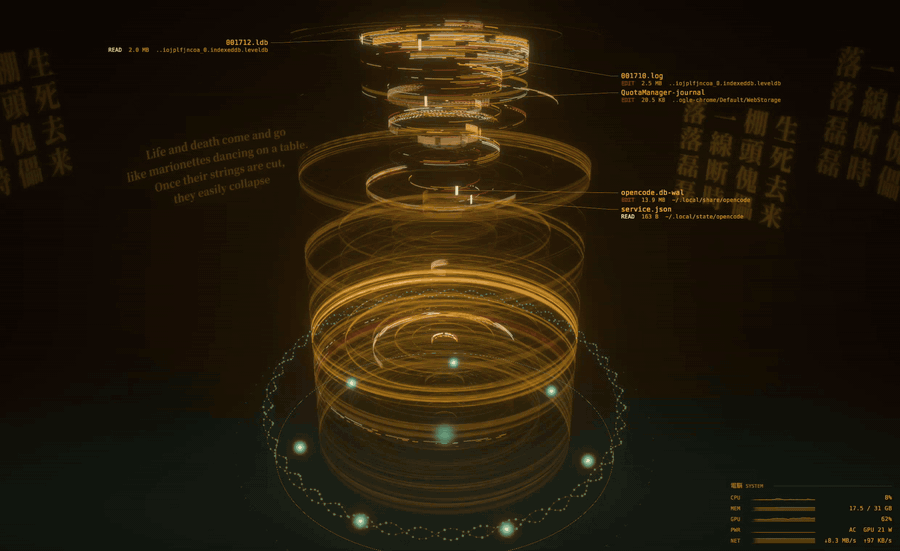

# gits-file-visualizer

<p align="center">
  
</p>

<p align="center"><em>Captured live on a real desktop: the tower reacting to actual file activity.</em></p>

A live GNOME desktop wallpaper that renders your filesystem as the glowing
security-system tower from the LOCUS SOLUS hack in *Ghost in the Shell 2:
Innocence*. Directories are bands of stacked rings and files are arc segments.
Like a disk-usage ring chart (Filelight, Disk Usage Analyzer), a folder's files
sit closer to the axis the nearer the folder is to your home folder, and
deeper folders form shells further out. Reads flash cream, writes turn crimson,
new files grow along their ring, and deleted files snap loose and fall apart
into gold flakes. Callouts beside the tower name the files being touched (NEW,
EDIT, READ, DELETED), several dozen at a time.

Targets Ubuntu 22.04, 24.04 and 26.04 (GNOME 42 / 46 / 50).
Design: [docs/DESIGN.md](docs/DESIGN.md).

## Status

- **M0 (look-dev) — done.** Synthetic home directory and a looping scripted
  work session, used for look-dev and reproducible snapshots.
- **M1 (real data) — done.** `gits-collector` scans your home folder, watches
  it for changes and streams them to the renderer.
- **M2 (wallpaper) — done for GNOME 42–44 and 45–46** (Ubuntu 22.04 and
  24.04; GNOME 46 tested in the headless sandbox). A GNOME Shell
  extension starts the renderer and shows it as the background on every
  monitor, including the overview and workspace switching, and pauses monitors
  that are covered. GNOME 47+ (Ubuntu 26.04) is untested. Both Wayland and X11
  sessions work (on GNOME 45+; the GNOME 42 extension is Wayland-tested).

## Build and run

Only [rustup](https://rustup.rs) is needed; `rust-toolchain.toml` pins the
compiler, and rustup installs it automatically. No system `-dev` packages are
required. At runtime the binary loads the GPU driver (Vulkan) and
Wayland/X11 libraries that every Ubuntu desktop already has.

### As your wallpaper (Ubuntu 22.04 / GNOME 42, Ubuntu 24.04 / GNOME 46)

```sh
tools/install-user.sh              # build; install to ~/.local; start the collector service
gnome-extensions enable gits-file-visualizer@iliabaranov.github.io     # wallpaper on
gnome-extensions disable gits-file-visualizer@iliabaranov.github.io    # wallpaper off
tools/install-user.sh uninstall    # remove everything again
```

On Wayland, GNOME only notices a newly installed extension after logging out
and back in once; the script says when that is needed. The extension:

- starts `gits-render wallpaper` (from `~/.local/bin`, `PATH`, or
  `GITS_RENDER_BIN`) and shows its output as the background of every monitor,
  in the overview and during workspace switches; the lock screen keeps the normal
  wallpaper;
- keeps the renderer's windows out of the dock, alt-tab and the overview;
- pauses a monitor while windows cover it, and everything while the screen is
  locked;
- picks a view per monitor (`[monitors]`, default `auto`): the largest landscape
  screen and portrait screens get the whole tower, others the top-down dial;
- pauses a monitor once windows cover most of it (`[performance]
  pause_when_covered`, 80%);
- can switch file names to hex codes while a screencast or screen share is
  running (`[privacy] obfuscate_when_sharing = true`; off by default);
- restarts the renderer if it crashes (at most 5 times in 5 minutes) and when
  monitors change; if the renderer is missing, the normal wallpaper stays.

Logs: `journalctl --user -f -o cat /usr/bin/gnome-shell | grep gits`.

Rendering (see `[performance]` in `config/default.toml`):

- 60 fps, timed to the display refresh (each frame is released by the
  compositor's frame callback), with every animation advancing by the real
  time elapsed. No motion trails and no film grain by default.
- On the discrete GPU (NVIDIA) when on mains power (`gpu = "auto"`). The tower
  is drawn at 58% of each monitor's resolution and upscaled the way games do
  (bicubic, clamped against ringing, lightly sharpened, like FSR 1), while
  text, labels and the system monitor are drawn afterwards at full resolution.
  `render_scale` sets the trade-off. On battery it switches to the integrated
  GPU at reduced resolution and 30 fps, restarting itself when the power
  source changes.
- The main monitor (the wide shot) shows a small system readout in the lower
  right: CPU, memory, GPU, power and network with one-minute sparklines
  (`[system_monitor] show = "main" | "all" | "off"`). It reads /proc and /sys
  (and NVIDIA's NVML library if present) once a second, only while visible.
- Where many rings share a pixel, all of them are averaged (up to 16), so the
  drum reads as fine striations instead of crawling noise.
- Layouts are rebuilt on a worker thread (at most every 5 s, which is when new
  files appear), and rings keep their texture rows, so file-system changes
  never stall a frame.

Measured headlessly on the development laptop (RTX 2060 Max-Q, three monitors
1920×1200 + 1080×1920 + 3840×2160, live data, 2026-09-28): 60 fps with the
longest frame ~17 ms; NVIDIA board power ~36 W at the default `render_scale`
(0.58), ~54 W at 0.67, ~63 W at native resolution; renderer ~25% of one CPU
core (~40% during the stress test below). Nothing is drawn while windows cover
the monitors.
`gits-render loadtest` measures this on your machine; `gits-render gpu-check`
lists which GPUs can present to a window.

Logs: `journalctl --user -b _COMM=gits-render -f` (renderer) and
`journalctl --user -f -o cat /usr/bin/gnome-shell | grep gits` (extension).

### With your real files, in a window

```sh
gits-render window                 # uses the collector if running (Esc or q quits)
```

Or without installing anything, in two terminals:

```sh
cargo run --release -p gits-collector                  # scan + watch + serve
cargo run --release -p gits-render -- window           # connects automatically
cargo run --release -p gits-collector -- monitor       # print changes as they stream (debugging)
cargo run --release -p gits-collector -- scan          # one-off scan: counts + watch budget
```

The collector runs at idle CPU and I/O priority and serves a Unix socket at
`$XDG_RUNTIME_DIR/gits-file-visualizer/collector.sock` that only your user can
open. `[data] source = "auto"` (default) makes the renderer use the collector
when it is running and fall back to synthetic data otherwise; `--source
collector|synthetic` forces one.

### Look-dev with synthetic data

```sh
cargo run --release -p gits-render -- window --warmup 150   # window; Esc or q quits
cargo run --release -p gits-render -- snapshot --out out/shot.png --at 160
cargo run --release -p gits-render -- snapshot --out out/seq/s.png --at 60 --frames 12 --every 25
cargo run --release -p gits-render -- bench --width 3840 --height 2160   # renders flat out: GPU at 100%
cargo run --release -p gits-render -- loadtest --source collector       # real wallpaper pacing, CPU/GPU cost
cargo run --release -p gits-render -- stats --minutes 15
cargo run --release -p gits-render -- default-config > my-config.toml
```

### Quality knobs

The tower's packed drum (where many rings share a pixel) is most of the GPU
work. These `[performance]` settings trade its detail for speed; the grain or
softness shows mostly while the rings turn, so judge them on the live
wallpaper, which reloads a second after you save the config. GPU time per 4K
frame on an RTX 2060, default = 1.46 ms in total:

| Setting | Default | Lower | Saves | Looks |
|---|---|---|---|---|
| `render_scale` (or per monitor, `[monitors."DP-6"] render_scale`) | 0.58 | 0.5 | ~0.1 ms at 4K | softer tower on that screen |
| `ring_bins` | 1024 | 512 / 256 | ~0.05 ms | softer, blurrier arcs |
| `dense_samples` | 16 | 8 | ~0.1 ms | grainier striations where the cache is not used |
| `cache_blocks` | 3 | 1–2 | a few % | softer, blurrier bands in the packed drum |
| `back_face_detail` | 0.25 | 0.1 | little (the far side is cheap now) | grainier far side |
| `shell_cache` | true | false | (costs +0.3 ms) | slightly sharper drum |
| `dither` | true | false | ~0.07 ms | banding in dark gradients |

On an integrated GPU (no discrete one, or on battery) the default draws the whole
wallpaper, text included, in a small window that GNOME scales up, which is soft.
For a sharp result set `integrated_native_window = true`: the window stays at the
monitor's size, text stays crisp, and only the tower is drawn at
`integrated_render_scale`. Frame rate is then the main lever on GPU load
(Radeon 780M, 2560x1600, renderer process only: 15 fps 7-10%, 20 fps 10-13%,
30 fps 13-16%, 60 fps 25%). `pause_on_battery = true` draws nothing while
unplugged.

### If the wallpaper looks stuck

```sh
gits-restart               # or click its dock icon, press Super+Shift+W, or search "Restart wallpaper"
gits-restart --renderer    # quicker: only the renderer
gits-restart --all         # also the file-watching collector (rescans your files)
```

It puts the saved monitor layout back, turns the GNOME extension off and on
(rebuilding its copies of the wallpaper on every monitor), starts a fresh
renderer and checks that every monitor picked it up: about 3 seconds.
`tools/install-shortcut.sh` installs the command, its icon, the launcher entry,
a pin in the dock and the shortcut (`'<Super><Alt>r'` for another key,
`--no-dock` to skip the pin; `uninstall` removes all of it). A notification
says "Restarting..." and then how many monitors came back.

### Screensaver (GNOME 45+)

After `[screensaver] after` of inactivity (default 5 minutes, not while a video
or presentation inhibits idle) the tower takes over every monitor, above windows
and the panel; any input ends it. GNOME blanks the display at its own blank time
(Settings > Power > Screen Blank, `org.gnome.desktop.session idle-delay`), which
decides how long the screensaver runs: `gsettings set org.gnome.desktop.session
idle-delay 3900` is 5 minutes plus one hour. `after = 0` or `enabled = false`
turns it off. Not available in the GNOME 42 extension. See "Lock screen" below
for the lock screen.

### On another machine without building

```sh
tools/make-bundle.sh      # -> out/gits-file-visualizer-linux-x86_64.tar.gz (~6 MB)
```

Copy the file over, then on the other machine (x86_64 Linux with glibc 2.34+,
e.g. Ubuntu 22.04 or newer; no Rust needed):

```sh
tar xzf gits-file-visualizer-linux-x86_64.tar.gz && gits-file-visualizer/install.sh
```

On GNOME 42–46 the wallpaper starts after the next login (on X11, restart the
shell once instead: Alt+F2, `r`).

### Keeping the monitor layout after login

GNOME sometimes restores the wrong monitor layout after login (the monitors
come up on different connectors, or late). `tools/display-layout.py` fixes it:

```sh
python3 tools/display-layout.py save      # remember the current layout
python3 tools/display-layout.py install   # restore it at every login (re-checked for 3 minutes)
python3 tools/display-layout.py show      # compare saved and current
```

### Stress test: watch a flurry of changes

```sh
python3 tools/stress.py                            # ~3 minutes, every kind of change
python3 tools/stress.py --phase mixed --seconds 0  # steady mix until Ctrl-C
python3 tools/stress.py --rate 3                   # three times as busy
gits-collector monitor --filter gits-stress --reads   # the changes as the collector sees them
```

It works only inside `~/gits-stress` (made and removed by the script) and
runs through phases: creating folders and files, slow edits, a build (many
reads, writes and new files), browsing photos, a clean-up (deletes), a burst of
everything, a steady mix, and removing the folder. Show the desktop (or press
Super) to watch; the wallpaper pauses while windows cover it. New files appear
within ~5 s; reads, edits and deletes immediately.

### Testing the extension safely

`tools/sandbox-shell.sh` runs a separate, headless GNOME Shell with its own
home, runtime directory, D-Bus and three virtual monitors; nothing touches the
real session. `start`, `eval 'JS'`, `shot file.png`, `run gnome-calculator`,
`log`, `stop`. `GITS_COLLECTOR_SOCKET=$XDG_RUNTIME_DIR/gits-file-visualizer/collector.sock`
connects it to the real collector.

`--warmup` simulates that many seconds of activity before the first frame.
`--seed` and `--scale` change the synthetic home. `snapshot`, `bench` and
`stats` use synthetic data unless given `--source collector`. Snapshots and
other scratch output go to `out/`, which is ignored by git.

## Lock screen

Off by default. With `[lock_screen] live = true` the tower keeps running behind
GNOME's clock and password prompt (both extensions; the extension is
only reloaded at login). File names are hidden while locked unless
`show_names = true`, and the system readout is hidden. `blur = 0` (default)
shows the picture sharp and is also the cheapest: a blurred live image is
re-blurred every frame and ballooned memory in testing. The renderer stops
drawing while GNOME reports the displays as switched off (and resumes when
they wake).

GNOME turns the monitors off as soon as the screen locks (about 30 s after the
last input on older versions), and a manual lock also fades to black. The GNOME 42
extension cannot change that, so there the live lock screen is only a background.
The GNOME 45+ extension can: with `live = true` it holds both back until you have
been idle for the blank time (`idle-delay`, see Screensaver above), so a locked
screen stays lit until then (with a blank time of 0 ("never") it stays lit). The
picture sits on an opaque black backing, never GNOME's wallpaper.

## Watch limit

Live change detection uses Linux inotify, which needs one *watch* per folder.
Ubuntu allows each user 65,536 watches (`fs.inotify.max_user_watches`), shared
with every other program that watches files: editors, sync clients such as
Nextcloud, browsers, and so on.

On a large home folder that is not enough for every folder. The collector
therefore takes at most half the limit (and always leaves 4,096 free); see
`[collector] max_watches`. It watches the top-level folders and the most
recently changed folders live. Everything else is re-checked by a slow
background crawl (`crawl_interval`, default 2 minutes), with this effect:

| | Live-watched folders | Crawled folders |
|---|---|---|
| New, deleted, renamed files | within ~0.1 s | on the next crawl pass (up to `crawl_interval`) |
| Writes to existing files | within ~0.1 s | not seen |
| Reads | within ~0.1 s | not seen |

A crawled folder in which the crawl finds changes is promoted to a live watch,
replacing the least recently active one, so busy folders end up watched.
`gits-collector scan` prints how many folders you have and how many fit.
Excluding big folders you do not care about (`[collector] excludes`) frees
watches.

On the development machine: 52k folders and 360k files after the default
excludes; 32,768 are watched live, and about 19k fall back to the crawl.

The limit can be raised system-wide if you want every folder watched (not done
by default; needs sudo; each watch costs about 1 KB of kernel memory):

```sh
echo fs.inotify.max_user_watches=262144 | sudo tee /etc/sysctl.d/60-gits-inotify.conf
sudo sysctl --system
```

## Configuration

Every option and its default lives in [`config/default.toml`](config/default.toml),
which is compiled into the binary. To customise, put only the keys you want to
change in `~/.config/gits-file-visualizer/config.toml`, or pass
`--config file.toml`. The window reloads the file while running. Unknown keys
are rejected, so typos surface immediately.

## Repository layout

| Path | Contents |
|------|----------|
| `crates/gits-core` | Filesystem model, tower layout, config, collector protocol, synthetic data |
| `crates/gits-collector` | Scanner + inotify watcher + socket server (`gits-collector`) |
| `crates/gits-render` | wgpu renderer, window mode, headless snapshots, benchmark |
| `crates/gits-render/shaders` | WGSL: tower, sprites, post-processing |
| `config/default.toml` | All defaults (compiled in) |
| `extension/gnome-42` | GNOME Shell 42–44 extension (wallpaper embedding) |
| `packaging/systemd` | User service for the collector |
| `tools/` | `install-user.sh` (per-user install), `sandbox-shell.sh` (isolated test shell), `make-fonts.sh` |
| `assets/fonts` | Bundled font subsets + licenses (compiled in; see `tools/make-fonts.sh`) |
| `docs/DESIGN.md` | Design, decisions, milestones |
| `docs/ref` | Low-res reference frames from the film (look-dev only) |

## Portability

Everything the project needs is in this repository: fonts are bundled
subsets, defaults are compiled in, the toolchain is pinned, `Cargo.lock` is
committed, and look-dev uses synthetic data, never the host filesystem. The only
things fetched from outside are crates from crates.io on the first build (cached
in `~/.cargo`).

Committing from a new machine: this GitHub account rejects pushes that expose a
private email address, so set the repo-local no-reply address once:
`git config user.email "90713890+iliabaranov@users.noreply.github.com"`.

## License

Apache License 2.0, see [LICENSE](LICENSE). The bundled fonts in `assets/fonts`
keep their own licenses (DejaVu under Bitstream Vera, Noto Serif CJK under the
SIL Open Font License 1.1), included next to the font files.
